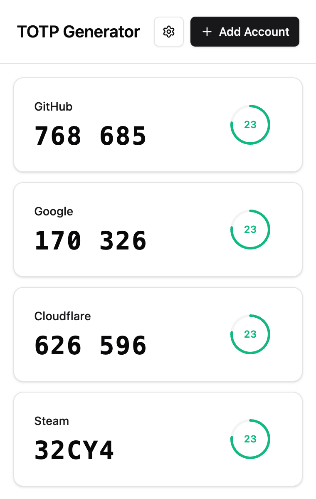
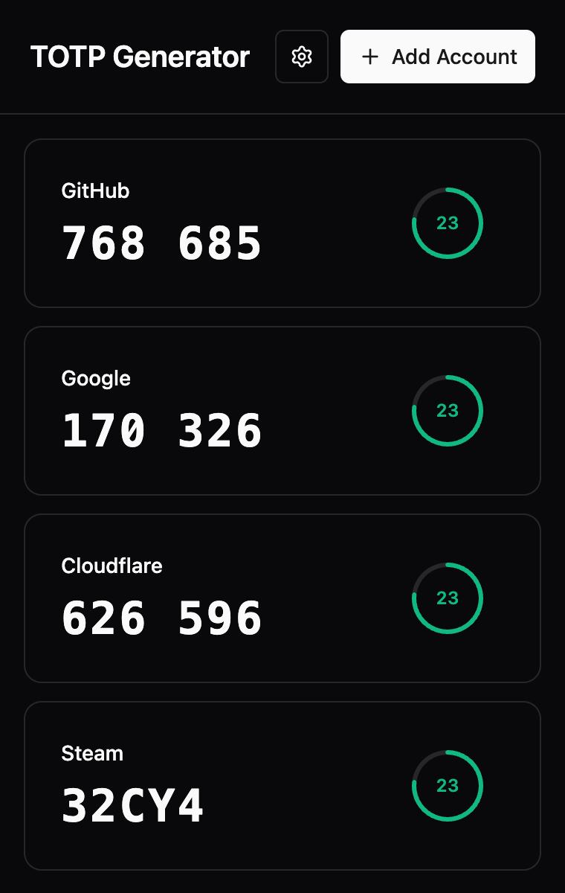

<p align="center">
  
</p>

<h1 align="center">MFA</h1>

<p align="center">
  <strong>Your verification codes. Right in your browser.</strong><br>
  A compact authenticator for TOTP, Steam Guard, and everyday sign-ins.
</p>

<p align="center">
  <a href="https://chromewebstore.google.com/detail/totp-authenticator-2fa-ot/dhipejmoajhjflafhbibojfoeogbmjgf"></a>
  <a href="https://github.com/titxue/mfa/actions/workflows/regression.yml"></a>
  <a href="https://opensource.org/licenses/MIT"></a>
</p>

<p align="center">
  <a href="https://chromewebstore.google.com/detail/totp-authenticator-2fa-ot/dhipejmoajhjflafhbibojfoeogbmjgf"></a>
</p>

<p align="center"><a href="https://mfa.xuejy.com/">Website</a> &nbsp;·&nbsp; <a href="#installation">Get started</a> &nbsp;·&nbsp; <a href="#usage">Usage</a> &nbsp;·&nbsp; <a href="#development">Development</a> &nbsp;·&nbsp; <a href="README.md">简体中文</a></p>

<p align="center">
  
  &nbsp;
  
</p>
<p align="center"><sub>Light and dark themes · Actual extension UI with demo accounts</sub></p>

Generate codes and read QR images locally, even offline. Use Chrome sync across devices, and enable a master passphrase when you want account encryption.


## Features

<table>
  <tr>
    <td width="50%" valign="top"><strong>Codes, ready offline</strong><br>Standard six-digit TOTP and five-character Steam Guard, with live countdowns.</td>
    <td width="50%" valign="top"><strong>Fill without retyping</strong><br>Click an account to fill a code. Enable per-site menus or clipboard fallback.</td>
  </tr>
  <tr>
    <td width="50%" valign="top"><strong>Bring your accounts</strong><br>Import QR images, otpauth links, or Google Authenticator export batches.</td>
    <td width="50%" valign="top"><strong>Back up with protection</strong><br>Use a master passphrase, manual locking, and encrypted JSON backups.</td>
  </tr>
  <tr>
    <td width="50%" valign="top"><strong>Keep things organized</strong><br>Edit accounts, drag to reorder, and export individual account QR codes.</td>
    <td width="50%" valign="top"><strong>Make it yours</strong><br>Choose from 12 main-interface languages and light, dark, or system themes.</td>
  </tr>
</table>

## Installation

1. **Install** — Add MFA from the [Chrome Web Store](https://chromewebstore.google.com/detail/totp-authenticator-2fa-ot/dhipejmoajhjflafhbibojfoeogbmjgf) and pin it to the toolbar. Requires Chrome 102+.
2. **Add an account** — Click “+”, then upload or paste a QR image, paste an otpauth link, or enter a secret. Review and save.
3. **Use a code** — Open MFA on your sign-in page and click an account to fill its code. Clipboard fallback can be enabled in settings.

<details>
<summary><strong>Build and load from source</strong></summary>

Install Bun 1.2+ and run:

```bash
git clone https://github.com/titxue/mfa.git
cd mfa
bun install
bun run build
```

1. Open `chrome://extensions/` and enable Developer mode.
2. Select Load unpacked and choose the project's `dist/` directory.
3. Pin the extension to the toolbar and click its icon to open your accounts.

To update a development build, rebuild and select Reload on the extensions page. Keep the same loading directory; uninstalling removes the extension's local data. Store and development builds usually have different extension IDs and separate accounts. Use a backup to migrate between them.

</details>

## Usage

| Action | How |
| --- | --- |
| Fill a code | Open the extension on the target webpage and click an account card |
| Copy when filling fails | Enable clipboard fallback in settings |
| Edit or delete an account | Right-click its card and choose the corresponding menu item |
| Display or download a QR code | Right-click the card and select Show QR Code |
| Reorder accounts | Drag account cards |
| Use the webpage account menu | Right-click the target webpage and enable the automatic menu through the extension's menu, then approve access; site access settings provide the same option |

The webpage menu also requires its global setting to be enabled. Individual site grants can be revoked. Chrome internal pages and restricted pages such as the Chrome Web Store do not allow filling scripts. See the [site access guide](docs/SITE_ACCESS.md) (Chinese).

<details>
<summary><strong>Account setup and Steam secret formats</strong></summary>

Click “+” to open the account form, then choose an input method:

- **QR image**: Select Scan QR Code, or paste or drop an image. A standard QR code fills the form for review before saving.
- **Link**: Paste an `otpauth://totp/` link, review the parsed account, and save.
- **Manual entry**: Enter an account name and secret. Standard TOTP uses Base32; an optional website helps match accounts in the webpage menu.

For manual Steam entry, select Steam Guard and explicitly choose Base32 or Base64. The `shared_secret` in a `.maFile` is case-sensitive Base64. Do not infer the account type solely from the secret's length or appearance. Existing accounts can also change type through the edit menu.

</details>

<details>
<summary><strong>Import formats, migration, and backups</strong></summary>

Open Settings → Import to choose files, paste images or text, or drop files. Review and select accounts before confirming. Existing account names are skipped rather than overwritten.

| Input format | Support |
| --- | --- |
| This extension's JSON backups | Preview plain backups directly; enter the backup passphrase to decrypt and preview encrypted backups |
| otpauth links or QR codes | Standard TOTP and compatible Steam QR codes |
| Google Authenticator migration QR codes | `otpauth-migration://offline`; collect every QR code from the same export batch |
| TXT files | One supported link per line; blank lines and `#` comments are ignored |
| Third-party JSON arrays | The `extract_otp_secrets` export format |
| Steam `.maFile` / JSON | Unencrypted files; only `account_name` and `shared_secret` are imported |

For Google Authenticator, use its transfer or export feature, then add each exported QR image. The preview tracks batch progress and ignores repeated scans. Closing the import dialog clears unsaved preview data.

Standard TOTP supports only SHA1, 6 digits, and a 30-second period. HOTP, other algorithms, digit counts or periods, and damaged entries produce errors or skip reasons. CSV, camera scanning, multiple independent QR symbols in one image, and proprietary backups outside the formats above are not supported.

Use Settings → Export to back up accounts. Password-protected accounts export encrypted JSON by default; plain export requires the current passphrase. Without protection, exports are plaintext JSON. Encrypted backups always require the passphrase used at export time; changing the master passphrase does not update old backups.

</details>

<details>
<summary><strong>Steam Guard enrollment and local helper</strong></summary>

Add an existing secret manually or import a `.maFile`. Login sessions, tokens, `identity_secret`, and recovery codes are not imported as account data. Codes are generated locally. Exported QR codes include a Steam type marker, which the receiving application must also support.

Settings → Set up Steam Guard opens a dedicated page for passphrase login, email or mobile verification, status checks, key initialization, phone-code verification, and saving. It requests Steam API access when needed, without granting webpage filling access. It does not automatically revoke or transfer an existing authenticator. Steam QR login and trade confirmations are not supported.

Pending enrollment keys are encrypted locally, and a recovery checkpoint can be downloaded. After restarting the browser, sign in again and unlock the checkpoint. Keys must be verified before they can be saved to the vault or exported as an importable encrypted backup. Browser enrollment still needs live-account verification; simulated tests do not establish that online enrollment works.

The repository also includes a separate experimental [local Steam linking helper](tools/steam-link/README.md) (Chinese) for testing enrollment shared with the official mobile app. It is not included in the extension package.

</details>

## Password protection and sync

Password protection is off by default. Without it, the extension does not encrypt account records before writing them to Chrome sync storage. Enable protection in settings with a master passphrase of at least 8 characters to encrypt account names, secrets, and websites.

- **Locking**: Closing the popup does not lock accounts. Lock manually, or unlock again after a browser restart or extension reload. Unlock state stays in the local browser session.
- **Password management**: Changing the passphrase or disabling protection requires the current passphrase. Disabling protection restores plaintext storage. Forgotten passphrases cannot be recovered; encrypted backups also require their corresponding passphrase.
- **Device sync**: Devices need the same extension ID, Chrome account, and extension data sync enabled. Data stays local while offline or sync is disabled, and resumes syncing when connected with sync enabled.
- **Sync boundaries**: A successful local save does not confirm delivery to another device. Offline devices may retain old copies. Simultaneous edits on several devices are not guaranteed to merge.
- **Capacity**: All accounts share one sync record, subject to approximately 8 KB per item and 100 KB in total. Oversized writes fail rather than truncating accounts. See the [Chrome Storage documentation](https://developer.chrome.com/docs/extensions/reference/api/storage#sync).

QR codes and backups contain secrets that can restore verification codes. Store them carefully. See [passphrase protection and Chrome sync](docs/PASSWORD_PROTECTION.md) (Chinese) for implementation details and limitations.

<details>
<summary><strong>What permissions does MFA use?</strong></summary>

| Permission | Purpose |
| --- | --- |
| `storage` | Store accounts, settings, and local session state |
| `activeTab` | Temporarily access the current webpage after the user opens the extension to fill a code |
| `scripting` | Inject field detection and filling scripts into permitted pages |
| `contextMenus` | Provide per-site menu enable/disable actions |
| Optional HTTP / HTTPS host permissions | Per-site access for webpage menus; Steam enrollment separately requests Steam API access when needed |

Optional host permissions do not grant access to all websites at installation. Users can review and revoke site grants in settings.

</details>

## Development

Built with **React 19 · TypeScript · Bun · Tailwind CSS · shadcn/ui**, using **Manifest V3**. Start here to build, test, or contribute.

<details>
<summary><strong>Requirements and commands</strong></summary>

Building the extension requires Bun 1.2+. Full checks and the local Steam helper also require Node.js 22+ and npm, matching the CI environment. Run the following commands from the repository root:

| Command | Purpose |
| --- | --- |
| `bun install` | Install extension and test dependencies |
| `bun run dev` | Watch source, public assets, and build configuration; rebuild on changes |
| `bun run build` | Produce the extension in `dist/` |
| `bun run type-check` | Check TypeScript; build first on a fresh checkout to generate the version module |
| `bun run test:unit` | Run unit and component tests |
| `bun run test:e2e` | Build and run Playwright browser tests |
| `bun run steam:link:test` | Run local Steam helper tests |
| `bun run steam:link:check` | Type-check the local Steam helper |
| `bun run test` | Run unit, Steam helper, and browser tests in sequence |
| `bun run generate-icons` | Generate extension icons using Canvas |

`bun run dev` batches changes and rebuilds serially, continuing after failures. Reload the extension manually in Chrome after a rebuild.

</details>

<details>
<summary><strong>Run all checks</strong></summary>

```bash
bun install
npm ci --prefix tools/steam-link --ignore-scripts --no-audit --no-fund
bunx playwright install chromium
bun run build
bun run type-check
bun run steam:link:check
bun run test
```

On Linux, use `bunx playwright install --with-deps chromium` to install browser system dependencies. Browser tests use synthetic accounts and isolated temporary profiles. They do not read your everyday Chrome accounts or verify live Chrome sync or Steam enrollment.

[CI](.github/workflows/regression.yml) runs on pull requests and pushes to `master` / `main`. Failed browser runs save screenshots and traces under `output/playwright/results/`; CI uploads these diagnostics. See the [browser regression guide](tests/browser/README.md) for the manual DOM test entry point.

</details>

<details>
<summary><strong>Architecture and website build</strong></summary>

```text
src/
├── popup/               # Extension popup entry point
├── components/          # Accounts, settings, import, and protection UI
├── contexts/            # Language and theme contexts
├── hooks/               # Account, code, and settings state
├── locales/             # Main UI and feature-specific translations
├── utils/               # TOTP, QR, import, vault, and webpage filling
├── steam-link/          # In-extension Steam enrollment page and backend
├── types/               # TypeScript types
├── background.ts        # Service worker entry point
├── vault-background.ts  # Vault messages and sender checks
└── content-script.ts    # Webpage field detection, menus, and filling
public/                  # Manifest, icons, and static assets
scripts/                 # Development file watcher
tests/                   # Unit, component, DOM, and extension browser tests
tools/steam-link/        # Standalone local Steam helper
website/                 # Project website
docs/                    # Guides, compatibility reviews, and release records
build.ts                 # Bun build and version synchronization
```

The background `VaultService` owns account operations, and the popup calls it through messages. Webpage scripts receive authorized account summaries and codes, not secrets. The frontend uses React 19, TypeScript 5.9, Tailwind CSS 3.4, shadcn/ui, and Radix UI. jsQR reads QR codes, qrcode generates them, and dnd-kit handles sorting.

`package.json` is the version source. The build generates `src/version.ts` and updates the output Manifest. Do not edit generated files manually. Build the website separately:

```bash
npm ci --prefix website
npm --prefix website run build
```

The website build synchronizes the extension version from the root `package.json`.

</details>

<details>
<summary><strong>Internationalization</strong></summary>

The main interface detects the browser language and also allows manual selection:

| Language | Code | Language | Code |
| --- | --- | --- | --- |
| 简体中文 | `zh-CN` | Deutsch | `de-DE` |
| 繁體中文 | `zh-TW` | Русский | `ru-RU` |
| English | `en-US` | العربية | `ar-SA` |
| Español | `es-ES` | 日本語 | `ja-JP` |
| Français | `fr-FR` | 한국어 | `ko-KR` |
| Português | `pt-BR` | हिन्दी | `hi-IN` |

To add a language, create `src/locales/xx-XX.ts`, register it in `src/locales/index.ts`, and update security, import, Steam, inline-menu, and store metadata strings. The Steam enrollment wizard currently provides Chinese and English, with English fallback for other languages. See the [language guide](docs/ADD_NEW_LANGUAGE.md) (Chinese).

</details>

## FAQ

<details>
<summary><strong>Why is a code incorrect?</strong></summary>

Check the computer clock, account type, secret encoding, and the service's required algorithm, digit count, and period. Standard TOTP and Steam Guard use different output encodings.

</details>

<details>
<summary><strong>Why does filling fail?</strong></summary>

Chrome may restrict the page, or the input may not be recognized. Enable clipboard fallback and paste manually. The webpage account menu requires both site permission and its global setting to be enabled.

</details>

<details>
<summary><strong>Why are accounts missing on another device?</strong></summary>

Check the extension ID, Chrome account, and extension data sync settings on both devices, then allow time for sync. After receiving encrypted records, unlock them with the same master passphrase.

</details>

## Documentation and contributing

- [Password protection and sync](docs/PASSWORD_PROTECTION.md) (Chinese)
- [Site access and webpage menus](docs/SITE_ACCESS.md) (Chinese)
- [Local Steam linking helper](tools/steam-link/README.md) (Chinese)
- [Store feature compatibility review](docs/STORE-FEATURE-COVERAGE-20261102.md) (Chinese)
- [2.3.9 release and upgrade verification](docs/RELEASE-2.3.9.md) (Chinese)
- [GitHub Releases](https://github.com/titxue/mfa/releases)

Use [Issues](https://github.com/titxue/mfa/issues) for bugs and suggestions, or submit a [Pull Request](https://github.com/titxue/mfa/pulls). Include reproduction steps, browser version, and extension version in bug reports. Do not submit real account secrets, QR codes, or backups. Code changes should pass relevant tests, type checks, and builds, with both README versions kept in sync.

---

<p align="center">
  <a href="https://opensource.org/licenses/MIT">MIT License</a> &nbsp;·&nbsp;
  <a href="https://github.com/titxue/mfa/issues">Report an issue</a> &nbsp;·&nbsp;
  <a href="https://github.com/titxue/mfa/releases">Release history</a>
</p>
