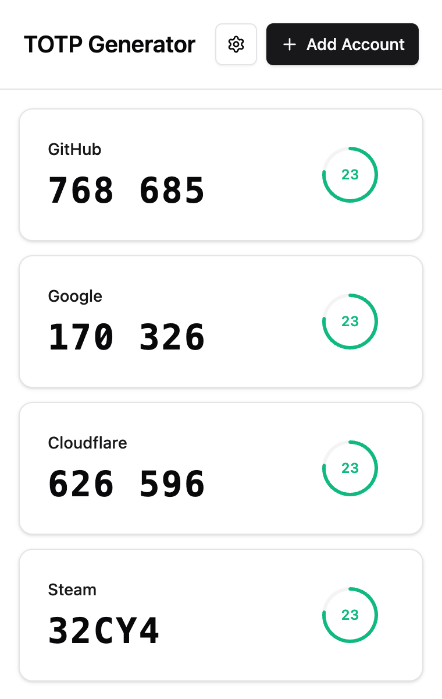
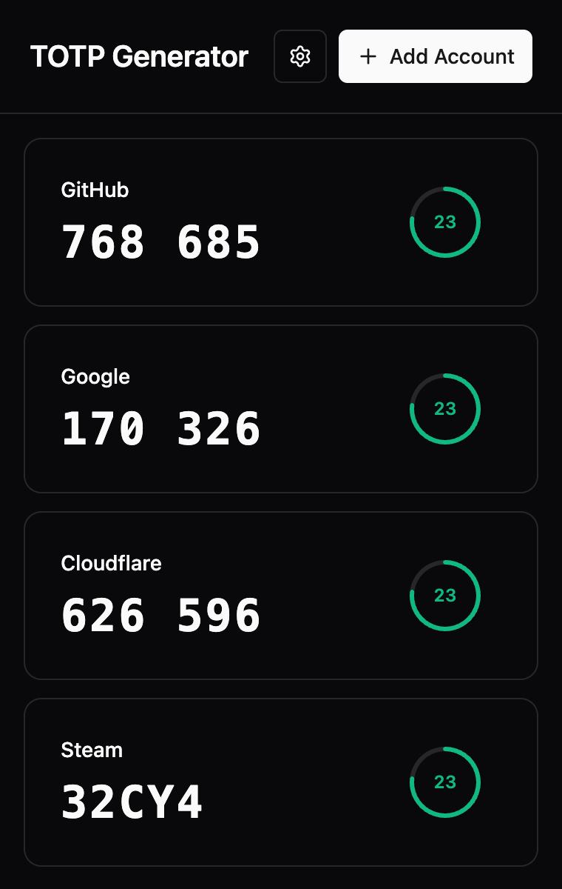

<p align="center">
  
</p>

<h1 align="center">MFA</h1>

<p align="center">
  <strong>验证码，就在浏览器里。</strong><br>
  一个简洁的浏览器认证器，让 TOTP、Steam Guard 与日常登录触手可及。
</p>

<p align="center">
  <a href="https://chromewebstore.google.com/detail/totp-authenticator-2fa-ot/dhipejmoajhjflafhbibojfoeogbmjgf"></a>
  <a href="https://github.com/titxue/mfa/actions/workflows/regression.yml"></a>
  <a href="https://opensource.org/licenses/MIT"></a>
</p>

<p align="center">
  <a href="https://chromewebstore.google.com/detail/totp-authenticator-2fa-ot/dhipejmoajhjflafhbibojfoeogbmjgf"></a>
</p>

<p align="center"><a href="https://mfa.xuejy.com/zh/">项目官网</a> &nbsp;·&nbsp; <a href="#安装">开始使用</a> &nbsp;·&nbsp; <a href="#使用指南">使用指南</a> &nbsp;·&nbsp; <a href="#开发">开发文档</a> &nbsp;·&nbsp; <a href="README.en.md">English</a></p>

<p align="center">
  
  &nbsp;
  
</p>
<p align="center"><sub>浅色与深色主题 · 实际扩展界面，使用示例账户</sub></p>

验证码生成与二维码识别都在本机完成，离线也能使用。账户通过 Chrome 同步；需要加密保护时，可在设置中开启主密码。


## 功能

<table>
  <tr>
    <td width="50%" valign="top"><strong>离线生成，即开即用</strong><br>标准 TOTP 六位验证码与 Steam Guard 五位码，配合实时倒计时。</td>
    <td width="50%" valign="top"><strong>点击填入，省去抄写</strong><br>点击账户填入验证码，也可启用网站账户菜单与复制回退。</td>
  </tr>
  <tr>
    <td width="50%" valign="top"><strong>已有账户，轻松迁入</strong><br>支持二维码图片、otpauth 链接和 Google Authenticator 批量迁移。</td>
    <td width="50%" valign="top"><strong>备份与保护，自己掌握</strong><br>可选主密码保护、手动锁定和加密 JSON 备份，导入前先预览。</td>
  </tr>
  <tr>
    <td width="50%" valign="top"><strong>账户有序，操作顺手</strong><br>编辑账户、拖拽排序，按需显示二维码或下载 PNG 图片。</td>
    <td width="50%" valign="top"><strong>语言与主题，随你选择</strong><br>12 种主界面语言，支持浅色、深色和跟随系统。</td>
  </tr>
</table>

## 安装

1. **安装扩展** — 从 [Chrome Web Store](https://chromewebstore.google.com/detail/totp-authenticator-2fa-ot/dhipejmoajhjflafhbibojfoeogbmjgf) 添加 MFA，并固定到工具栏。需要 Chrome 102 或更新版本。
2. **添加账户** — 点击“+”，上传或粘贴二维码图片、粘贴 otpauth 链接，或手动输入密钥，确认后保存。
3. **填入验证码** — 在登录页面打开 MFA，点击账户即可尝试填入；也可在设置中开启填充失败时复制。

<details>
<summary><strong>从源码构建与加载</strong></summary>

准备 Bun 1.2+，执行：

```bash
git clone https://github.com/titxue/mfa.git
cd mfa
bun install
bun run build
```

1. 打开 `chrome://extensions/`，启用开发者模式。
2. 点击“加载已解压的扩展程序”，选择项目的 `dist/` 目录。
3. 将扩展固定到工具栏，点击图标打开账户列表。

更新开发版本时，重新构建并点击扩展管理页的“重新加载”。保留原加载目录；卸载重装会删除扩展的本地数据。商店版和开发版通常具有不同的扩展 ID，账户不会自动互通，可通过备份迁移。

</details>

## 使用指南

| 操作 | 方式 |
| --- | --- |
| 填入验证码 | 在目标网页打开扩展，点击账户卡片 |
| 填充失败时复制 | 在设置中开启“填充失败时复制” |
| 编辑或删除账户 | 右键账户卡片，选择对应菜单项 |
| 显示或下载二维码 | 右键账户卡片，选择“显示二维码” |
| 调整账户顺序 | 拖拽账户卡片 |
| 使用网页账户菜单 | 在目标网站右键，通过扩展菜单启用自动菜单并确认授权；也可在设置的“网站授权”中启用 |

网页账户菜单还受设置中的总开关控制，单个网站授权可以随时撤销。浏览器内部页和 Chrome Web Store 等受限页面无法注入填充脚本。详见[网站授权说明](docs/SITE_ACCESS.md)。

<details>
<summary><strong>添加账户与 Steam 密钥格式</strong></summary>

点击“+”打开添加窗口，选择以下方式之一：

- **二维码图片**：点击“扫描二维码”上传图片，也可以粘贴或拖拽图片。普通二维码解析后填入表单，确认后保存。
- **链接**：粘贴 `otpauth://totp/` 链接，检查解析出的账户信息后保存。
- **手动输入**：填写账户名称和密钥。普通 TOTP 使用 Base32 密钥；可选填网站信息供网页菜单匹配。

手动添加 Steam 账户时，选择“Steam Guard”，再明确选择 Base32 或 Base64 格式。`.maFile` 中的 `shared_secret` 使用区分大小写的 Base64。不要仅凭密钥长度或字符外观判断账户类型，已有账户也可通过编辑菜单调整类型。

</details>

<details>
<summary><strong>导入格式、批量迁移与备份</strong></summary>

在“设置 → 导入”中选择文件、粘贴图片或文本，也可以拖入文件。导入前先预览并选择账户，再确认保存；同名账户会跳过，不覆盖现有账户。

| 输入格式 | 支持范围 |
| --- | --- |
| 本扩展 JSON 备份 | 明文备份直接预览；加密备份先输入备份密码，再解密预览 |
| otpauth 链接或二维码 | 标准 TOTP，以及兼容的 Steam 二维码 |
| Google Authenticator 迁移二维码 | 支持 `otpauth-migration://offline`，同一批次的多张二维码需全部收齐 |
| TXT 文件 | 每行一个支持的链接，忽略空行和以 `#` 开头的注释 |
| 第三方 JSON 数组 | 支持 `extract_otp_secrets` 导出格式 |
| Steam `.maFile` / JSON | 支持未加密文件，只导入 `account_name` 和 `shared_secret` |

迁移 Google Authenticator 账户时，先在原应用使用转移或导出功能，再逐张添加导出图片。预览会显示批次进度，重复扫描不重复计数；关闭导入窗口会清空尚未保存的预览。

普通 TOTP 仅支持 SHA1、6 位、30 秒。HOTP、其他算法或位数、其他周期及损坏条目会显示错误或跳过原因。目前不支持 CSV、摄像头扫描、一张图片中的多个独立二维码，以及上述格式以外的专有备份。

在“设置 → 导出”中备份账户。开启主密码保护后默认导出加密 JSON；选择明文导出需要验证当前密码。未开启保护时导出明文 JSON。加密备份始终使用导出时的密码，之后修改主密码不会改变旧备份。

</details>

<details>
<summary><strong>Steam Guard 在线绑定与本地助手</strong></summary>

已有密钥可通过手动输入或 `.maFile` 导入。文件中的登录会话、令牌、`identity_secret` 和恢复码不会作为账户数据导入。验证码在本机生成；二维码导出使用 Steam 类型标记，接收应用也需要支持 Steam。

“设置 → 绑定 Steam Guard”可打开独立页面，进行账号密码登录、邮件或手机验证、状态检查、密钥初始化、手机验证码核对和保存。该流程按需申请 Steam API 权限，不授予网页自动填充权限，也不会自动解绑或转移已有验证器。不支持 Steam 扫码登录和交易确认。

待完成的绑定密钥加密保存在本机，可下载恢复检查点；浏览器重启后需重新登录并解锁检查点。核对成功后才能保存到账户库或导出可导入的加密备份。浏览器内绑定流程仍需真实账号验收，模拟测试不代表线上绑定已验证。

仓库另提供独立的实验性 [Steam 本地绑定助手](tools/steam-link/README.md)，用于验证与官方手机应用共用新令牌的流程，不包含在扩展发布包中。

</details>

## 密码保护与同步

密码保护默认关闭，账户记录在写入 Chrome 同步存储前不会由扩展加密。可以在设置中开启保护，使用至少 8 位的主密码加密账户名称、密钥和网站信息。

- **锁定**：关闭弹窗不会锁定；可手动锁定，浏览器重启或扩展重载后也需重新解锁。解锁状态只保留在本机浏览器会话中。
- **密码管理**：修改密码或关闭保护需要当前密码；关闭保护后恢复明文存储。忘记密码无法恢复，加密备份也需要对应密码。
- **跨设备同步**：需要相同扩展 ID、同一 Chrome 账号并启用扩展数据同步。离线或关闭同步时数据保存在本机，恢复联网并启用同步后继续同步。
- **同步边界**：本机保存成功不代表其他设备已收到更新；离线设备可能仍保留旧副本。同时在多台设备编辑不保证自动合并。
- **容量限制**：所有账户保存在单条同步记录中，受单项约 8 KB、同步总量约 100 KB 的限制。超限会报告失败，不会截断账户。配额见 [Chrome Storage 文档](https://developer.chrome.com/docs/extensions/reference/api/storage#sync)。

二维码和备份文件包含可恢复验证码的密钥，应妥善保存。详细实现与使用边界见[密码保护与 Chrome 同步](docs/PASSWORD_PROTECTION.md)。

<details>
<summary><strong>MFA 使用哪些权限？</strong></summary>

| 权限 | 用途 |
| --- | --- |
| `storage` | 保存账户、设置和本机会话状态 |
| `activeTab` | 用户打开扩展后，临时访问当前网页以填入验证码 |
| `scripting` | 向有权限的网页注入输入框识别与填充脚本 |
| `contextMenus` | 提供启用或禁用网站自动菜单的右键入口 |
| 可选 HTTP / HTTPS 主机权限 | 用户逐站授权网页菜单；Steam 绑定单独按需申请 Steam API 访问 |

可选主机权限不在安装时授予所有网站访问权。用户可以在设置中查看和撤销网站授权。

</details>

## 开发

基于 **React 19 · TypeScript · Bun · Tailwind CSS · shadcn/ui** 构建，使用 **Manifest V3**。构建、测试与参与贡献的入口如下。

<details>
<summary><strong>环境与常用命令</strong></summary>

扩展构建需要 Bun 1.2+；完整测试和 Steam 本地助手还需要 Node.js 22+ 与 npm，与 CI 环境保持一致。以下命令在仓库根目录执行：

| 命令 | 用途 |
| --- | --- |
| `bun install` | 安装扩展与测试依赖 |
| `bun run dev` | 监听源码、静态资源和构建配置，变更后重建 |
| `bun run build` | 生成生产构建到 `dist/` |
| `bun run type-check` | TypeScript 类型检查，首次运行前先构建以生成版本模块 |
| `bun run test:unit` | 单元与组件测试 |
| `bun run test:e2e` | 生产构建与 Playwright 浏览器测试 |
| `bun run steam:link:test` | Steam 本地助手测试 |
| `bun run steam:link:check` | Steam 本地助手类型检查 |
| `bun run test` | 依次运行单元、Steam 助手和浏览器测试 |
| `bun run generate-icons` | 使用 Canvas 生成扩展图标 |

`bun run dev` 会合并连续变更并串行重建，失败后继续监听。重建完成后仍需在 Chrome 中手动重新加载扩展。

</details>

<details>
<summary><strong>运行完整检查</strong></summary>

```bash
bun install
npm ci --prefix tools/steam-link --ignore-scripts --no-audit --no-fund
bunx playwright install chromium
bun run build
bun run type-check
bun run steam:link:check
bun run test
```

Linux 环境可使用 `bunx playwright install --with-deps chromium` 安装浏览器系统依赖。浏览器测试使用合成账户和独立临时配置，不读取日常 Chrome 账户，也不验证真实 Chrome 同步或 Steam 在线绑定。

[CI](.github/workflows/regression.yml) 在 Pull Request 和 `master` / `main` 推送时执行检查。浏览器测试失败时，截图和 trace 保存在 `output/playwright/results/`；CI 会上传诊断文件。手动 DOM 回归入口见[浏览器测试说明](tests/browser/README.md)。

</details>

<details>
<summary><strong>项目结构与官网构建</strong></summary>

```text
src/
├── popup/               # 扩展弹窗入口
├── components/          # 账户、设置、导入和密码保护界面
├── contexts/            # 语言与主题上下文
├── hooks/               # 账户、验证码和设置状态
├── locales/             # 主界面及功能模块文案
├── utils/               # TOTP、二维码、导入、账户库和网页填充
├── steam-link/          # 扩展内 Steam 绑定页面与后台逻辑
├── types/               # TypeScript 类型
├── background.ts        # Service Worker 入口
├── vault-background.ts  # 账户库消息处理与来源检查
└── content-script.ts    # 网页输入框识别、菜单和填充
public/                  # Manifest、图标等静态资源
scripts/                 # 开发模式文件监听
tests/                   # 单元、组件、DOM 与扩展浏览器测试
tools/steam-link/        # 独立 Steam 本地助手
website/                 # 项目官网
docs/                    # 使用指南、兼容性与发布记录
build.ts                 # Bun 构建与版本同步
```

账户读写由后台 `VaultService` 统一处理，弹窗通过消息调用；网页脚本只获取授权范围内的账户摘要与验证码，不获取密钥。前端使用 React 19、TypeScript 5.9、Tailwind CSS 3.4、shadcn/ui 和 Radix UI；二维码识别使用 jsQR，二维码生成使用 qrcode，拖拽排序使用 dnd-kit。

`package.json` 是版本号的唯一来源，构建时生成 `src/version.ts` 并更新输出的 Manifest。不要手动修改生成文件。官网在 `website/` 中单独构建：

```bash
npm ci --prefix website
npm --prefix website run build
```

官网构建会从根目录 `package.json` 同步扩展版本。

</details>

<details>
<summary><strong>国际化</strong></summary>

主界面自动检测浏览器语言，也可在设置中手动选择：

| 语言 | 代码 | 语言 | 代码 |
| --- | --- | --- | --- |
| 简体中文 | `zh-CN` | Deutsch | `de-DE` |
| 繁體中文 | `zh-TW` | Русский | `ru-RU` |
| English | `en-US` | العربية | `ar-SA` |
| Español | `es-ES` | 日本語 | `ja-JP` |
| Français | `fr-FR` | 한국어 | `ko-KR` |
| Português | `pt-BR` | हिन्दी | `hi-IN` |

添加语言时，创建 `src/locales/xx-XX.ts`，在 `src/locales/index.ts` 注册，并补齐安全、导入、Steam、网页菜单及商店元信息文案。Steam 绑定向导目前提供中文和英文，其他语言回退到英文。详见[添加新语言指南](docs/ADD_NEW_LANGUAGE.md)。

</details>

## 常见问题

<details>
<summary><strong>验证码不正确时如何排查？</strong></summary>

先检查电脑时间是否准确，再核对账户类型、密钥格式与服务要求的算法、位数和周期。普通 TOTP 和 Steam Guard 的编码方式不同。

</details>

<details>
<summary><strong>为什么自动填充失败？</strong></summary>

目标页面可能受 Chrome 限制，或使用了无法识别的输入框。可启用“填充失败时复制”后手动粘贴。网页账户菜单需要单独授权目标网站并保持总开关开启。

</details>

<details>
<summary><strong>为什么另一台设备没有账户？</strong></summary>

确认两端扩展 ID、Chrome 账号及扩展数据同步设置一致，并等待同步完成。收到加密记录后，还需要使用同一主密码解锁。

</details>

## 文档与贡献

- [密码保护与同步](docs/PASSWORD_PROTECTION.md)
- [网站授权与网页菜单](docs/SITE_ACCESS.md)
- [Steam 本地绑定助手](tools/steam-link/README.md)
- [商店功能兼容性检查](docs/STORE-FEATURE-COVERAGE-20261102.md)
- [2.3.9 发布与升级验证记录](docs/RELEASE-2.3.9.md)
- [GitHub Releases](https://github.com/titxue/mfa/releases)

欢迎通过 [Issues](https://github.com/titxue/mfa/issues) 反馈问题或提出建议，通过 [Pull Requests](https://github.com/titxue/mfa/pulls) 提交改进。问题报告请附复现步骤、浏览器版本和扩展版本，不要提交真实账户密钥、二维码或备份文件。代码改动请通过相关测试、类型检查和构建，并同步更新中英文文档。

---

<p align="center">
  <a href="https://opensource.org/licenses/MIT">MIT License</a> &nbsp;·&nbsp;
  <a href="https://github.com/titxue/mfa/issues">反馈问题</a> &nbsp;·&nbsp;
  <a href="https://github.com/titxue/mfa/releases">版本记录</a>
</p>
